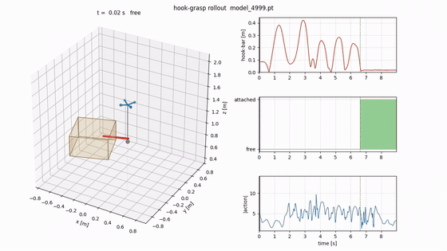

# Dynamic Hook Grasping with a Quadrotor via Reinforcement Learning

[](https://isaac-sim.github.io/IsaacLab/)
[](https://developer.nvidia.com/isaac/sim)
[](https://www.python.org/)
[](https://pytorch.org/)
[](https://github.com/leggedrobotics/rsl_rl)
-orange)
[](LICENSE)
> **LIS, EPFL — Semester project (MSc Robotics)** · Alessandro De Zen · Supervisors: [Fuda van Diggelen](https://people.epfl.ch/fuda.vandiggelen), [Jack Zeng](https://people.epfl.ch/jack.zeng) · Professor: [Dario Floreano](https://people.epfl.ch/dario.floreano)
>
> 🚧 **Ongoing project (until December 2026).** This repository is a work in progress and will be updated as the project advances.

A quadrotor carries a flexible wire with a hook at its end. In simulation, it learns with reinforcement learning to **swing the hook onto an object and grasp it**. The policy is trained with PPO in NVIDIA Isaac Lab and sends its commands to a classical low-level flight controller.

> 🎯 **Goal:** perform this dynamic **hook-and-grasp** manoeuvre on a **real quadrotor** ([OmniNxt](https://github.com/HKUST-Aerial-Robotics/OmniNxt)) with **zero-shot sim-to-real transfer**, i.e. the policy trained in simulation runs on the hardware without any fine-tuning.

<p align="center">
  
  <br/>
  <em>Policy rollout in simulation. The hook turns green once it is attached to the bar (red).</em>
</p>

---

## Highlights

- **Simulation and training** of the hook-grasp task in Isaac Lab 3.0 (Isaac Sim 6), with PPO.
- **Cluster pipeline**: Slurm + Apptainer jobs that train, evaluate and record policies on EPFL's GPU cluster ([`jobs/`](jobs)).
- **Faster training**: a larger-batch setup that cuts training time from about 7 h to about 3 h on a single GPU.
- **Visualisation tools that need no RTX GPU**: a 3D animation of the rollout and an interactive viewer that runs in the browser.
- **Model of the real drone**: CAD of the target quadrotor and of its propeller ([`cad/`](cad)), used to estimate the drone's inertia.

This work builds on two earlier projects:
- the multi-agent aerial manipulation framework of [Zeng et al.](https://arxiv.org/abs/2508.01522) ([upstream repository](https://github.com/Aerial-Manipulation-Lab/MARL_cooperative_aerial_manipulation_ext));
- the hook-grasp task of [F. van Diggelen](https://github.com/fudavd/MARL_cooperative_aerial_manipulation_ext/tree/hook-grasp-release).

---

## Repository structure

```
.
├── repos/
│   ├── MARL_cooperative_aerial_manipulation_ext/                 Isaac Lab extension with the hook-grasp task
│   └── MARL_cooperative_aerial_manipulation_ext_original_repo/   Upstream snapshot (reference)
├── jobs/              Slurm + Apptainer scripts
├── python_packages/   Vendored rsl_rl (PPO)
├── cad/               CAD of the drone and its propeller (STEP)
└── docs/images/       Figures
```

---

## Getting started

Requirements:
- an NVIDIA GPU;
- Isaac Lab 3.0, either the official container or a local install;
- [Git LFS](https://git-lfs.com/): the USD assets and the CAD files are stored with it, so run `git lfs install` before cloning.

The training, evaluation and visualisation commands are described in [`scripts/hook_grasp/README.md`](repos/MARL_cooperative_aerial_manipulation_ext/scripts/hook_grasp/README.md).

On a Slurm cluster, the scripts in [`jobs/`](jobs) wrap the same commands. Adapt their paths to your account first:

```bash
sbatch jobs/train_hook_grasp.sh                  # train a policy
sbatch jobs/play_hook_grasp.sh <checkpoint.pt>   # record a rollout (video + interactive viewer)
```

---

## License

- **Code**: [MIT](LICENSE). The upstream extension is also MIT, and the vendored rsl_rl is BSD-3-Clause.
- **CAD**: see [`cad/README.md`](cad/README.md).
